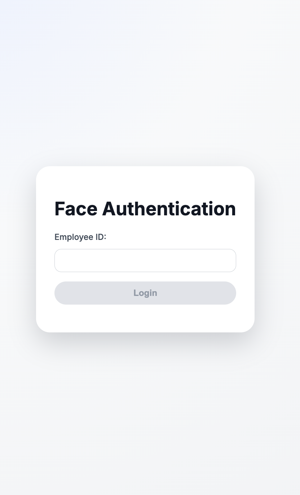

# Face Authentication Sample — Incode WebSDK

## Requirements

- Node.js ≥ 20

- NPM ≥ 7

Access to:

- Incode API URL

- SDK URL

- (Optional) Client ID / API key for 1:N matching

- Token server endpoint (if using biometrics validation through backend)

##Getting Started

####1. Install Dependencies
``npm install``

####2. Run the Development Server
``npm run dev``

You should have running your project at:
``http://localhost:5173/``

# Testing

### Positive Scenario
Enter a valid Identity Id registered in your organization and perform the Authentication

Expected Behavior:
The user should be able to login successfully

### Negative Scenario
Enter a not registered value and try to perform the Authentication

Expected Behavior:
The user should not be able to login in the platform.
